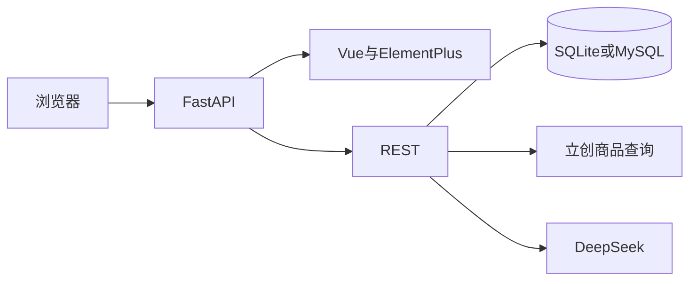

# 物品映射系统复刻方案

原站物品映射页是「壹刻定位」里的独立模块。本次只复刻物料库、物料盒地图、BOM 导入与匹配，以及登录所需的账号。设备监控、分组围栏、事件日志、产品中心、扫码填表不纳入。

项目根目录里的两份文件作为导入样例：

- `BOM_V1.31_V1.31_2026-10-23.xlsx`：立创 EDA 导出的分组 BOM
- `树莓派_PIOC2_RP2354B系统板_PCB1_20261020_083237-立创_20261020.xls`：立创商城 BOM 报价单

## 技术选型

- 后端：FastAPI + SQLAlchemy 2。默认 SQLite 文件，设置 `DATABASE_URL` 后可改为 MySQL。
- 前端：Vue 3 + Vue CLI 5（webpack）+ Element Plus + Vue Router。界面使用 Element Plus 的布局、表格、表单、对话框、分页、上传和描述列表，语言为简体中文。
- 部署：一个 Docker 镜像。构建阶段用 Vue CLI 产出静态文件，运行阶段由 FastAPI 同时提供页面和 `/api`。`docker compose up -d` 即可访问，SQLite 文件放在数据卷里。
- 外部服务只放在服务端：立创商品查询、DeepSeek。密钥只来自环境变量，不进入前端包。

## 数据模型

`users`：邮箱、密码哈希、创建时间。密码用 bcrypt，登录后写 HttpOnly Cookie。不做邮件找回密码。

`boxes` 物料盒：

- `name` 名称，同一用户内不重复
- `rows`、`cols` 行数和列数，创建时指定，不同盒子可以不同
- `remark` 备注
- 缩小行列时，如果已有物料落在范围外，拒绝保存并提示先移走

`items` 物料库，一条记录是库中的一种料及其存放位置：

- `lcsc_code` 立创商城商品编号，如 `C105580`。同一用户内有值时唯一，允许暂时为空
- `mpn` 厂家型号
- `name` 商品名称
- `brand` 品牌
- `footprint` 封装
- `category` 类目，如电阻、电容
- `value` 标称值，如 `5.1kΩ`、`4.7uF`
- `params` 参数原文，便于给人看，也给匹配用
- `quantity` 自有库存，整数
- `box_id`、`row`、`col` 所在物料盒和格子。空表示尚未入盒。同一盒子的同一格子只能放一条物料
- `datasheet_url`、`image_url`、`remark`

`projects` 与 `project_lines` 保存导入的项目 BOM，不直接改库存：

- 项目：名称、来源文件名、格式（`easyeda_v131` 或 `lcsc_quote`）、采购套数、导入时间
- 明细：位号、单板用量、需求总量、立创编号、厂家型号、品牌、封装、标称值、参数、商品名称、类目
- 匹配结果：状态、命中的物料 id、建议 JSON、生成时间

## 物料库

列表用 Element Plus 表格。可按立创编号、厂家型号、商品名称、封装、类目、备注筛选，分页。列包括编号、型号、名称、封装、类目、库存、物料盒、格子、操作。

新增和编辑用抽屉表单。立创编号输入框旁有「查询」：

- 后端请求 `https://wmsc.lcsc.com/ftps/wm/product/detail?productCode={code}`
- 把结果填进表单：编号、厂家型号、英文名称、品牌、标准封装、类目、关键参数、数据手册和图片
- 参数来自 `paramVOList`，拼成可读文本
- 立创返回的是商城库存和价格，只作参考，不写入自己的 `quantity`
- 查询失败时提示手填。这个接口不是官方开放平台，封装在单独模块里，便于以后更换

编号在编辑时可以改，但改完后仍须通过上述唯一性检查。库存数量、物料盒和格子由用户填写。

删除前确认。从盒子里移出时只清空位置，不删物料。

## 物料盒地图

单独一页管理物料盒：新建、改名、修改行列、删除。删除盒子时，盒内物料变为未入盒，不删除物料本身。

地图页：

- 顶部统计：物料种类、盒子数量、库存总数
- 每盒一张卡片，标题写名称和「R 行 × C 列」
- 格子按盒子设定的行列完整画出，空格子也显示。有料的格子显示立创编号或型号、库存数量
- 点击有料格子打开详情，可编辑或移出
- 点击空格子，可把未入盒物料放进去，或新建一条并直接放入该格
- 卡片下方列出该盒中坐标不合法的物料，以及全局「未入盒」列表
- 支持按类目筛选，并在匹配完成后用位号高亮对应格子

## BOM 导入

上传 `.xls` 或 `.xlsx` 后先识别格式，再生成一个项目和明细。两种样例都要能导入。

### 立创 EDA `BOM_V1.31`

表头在第一行，已核对的列：

- `No.` 行号
- `Quantity` 该料在项目中的用量（样例里同一种料已合并，没有位号）
- `Footprint` 封装
- `LCSC Price` 仅作来源判断，不入库为库存
- `Manufacturer` 品牌
- `Manufacturer Part` 厂家型号
- `Value` 标称值
- 其余列如 `Tolerance`、`Voltage Rated`、`Operating Temperature` 拼进参数

这份文件没有立创商品编号，也没有 `Designator`。明细里的立创编号留空，匹配时走厂家型号和参数。

### 立创商城报价单

文件标题为「立创商城BOM报价单」。表头同时包含原始需求和匹配结果，已核对的字段：

- 表头信息：`BOM名称`、`采购套数`、`BOM配单编号`
- 原始需求：`Manufacturer Part`、`Manufacturer`、`Footprint`、`原参数`、`Designator`、`Quantity`
- 商城匹配：`商品编号`、`商品名称`、`型号`、`品牌`、`封装`、`参数`、`目录`、`商品链接`、`购买数量`

`商品编号` 就是要保存的立创编码，例如 `C105580`。`Designator` 可能是 `R13,R14` 这种逗号分隔位号。需求总量优先用 `购买数量`；没有该列时用 `Quantity × 采购套数`。单板用量仍单独保存，结果里两种数量都展示。

识别规则：前几行出现「立创商城BOM报价单」或表头同时含「商品编号」和 `Designator`，按报价单解析；表头同时含 `Manufacturer Part`、`LCSC Price`、`Value`，按 EDA BOM 解析。都不符合则提示无法识别，不写入空项目。

## 与物料库匹配

导入后自动匹配，也可以在项目页重新匹配。每条明细一个状态：

- 已匹配：立创编号一致，或厂家型号在忽略大小写和空格后一致
- 库存不足：对上了，但库存小于需求总量
- 建议替换：没有精确命中，但库里有可替代料
- 未找到：库中没有合适器件

精确命中优先于替换建议。命中多条时列出库存位置，默认选库存足够且封装一致的一条。

替换建议分两步，避免把整库交给模型：

1. 规则预筛。封装主名相同（如 `0603`、`SOT-23`），或类目相同（电阻、电容、电感、二极管、MOS 等），或标称值相同。每条明细最多保留 20 个候选。
2. 把未精确命中的明细和候选发给 DeepSeek。只允许它从候选 id 里选择，返回 JSON：物料 id、是否适合替换、理由、需要人工确认的风险（耐压、精度、功率、温度、封装、库存）。候选以外的编号一律丢弃。

DeepSeek 使用 OpenAI 兼容接口，默认 `https://api.deepseek.com`，模型 `deepseek-chat`，密钥为 `DEEPSEEK_API_KEY`。未配置密钥时只保留精确匹配和规则预筛结果，并在页面上说明未启用智能建议。请求按小批量发送，单条失败不影响其余明细。

匹配页用表格展示：位号、用量、立创编号、型号、封装、状态、库中位置、库存/需求、替换理由。已匹配和建议替换的物料，在物料盒地图上标出位号。报价单里有立创编号但库中没有时，提供「按编号加入物料库」，走同一套立创查询，用户确认库存和盒子后再保存。

## 接口

均需登录，数据按当前用户隔离。

- `POST /api/auth/register`、`POST /api/auth/login`、`POST /api/auth/logout`、`GET /api/auth/me`
- `GET /api/lcsc/{code}` 查询立创商品并返回表单字段
- 物料的列表、新增、更新、删除、移出盒子
- 物料盒的列表、新增、更新、删除
- `POST /api/projects/import` 上传 BOM
- `GET /api/projects`、`GET /api/projects/{id}`
- `POST /api/projects/{id}/match` 重新匹配
- `POST /api/projects/{id}/lines/{lineId}/adopt` 按立创编号预填一条待确认物料

## 页面

- 登录、注册
- 物料列表
- 物料盒地图
- 项目 BOM：上传、明细、匹配结果、跳转到被高亮的盒子

视觉上沿用浅色后台：左侧菜单、内容区留白、Element Plus 默认主题并调成靛蓝主色。表格、空状态、上传区和匹配状态用标签区分。

## 验收

用项目里的两份样例文件验收：

- EDA 的 xlsx 能导入，46 行有效物料，厂家型号和封装正确，立创编号为空
- 立创报价单能导入，`C105580` 等商品编号、位号 `R13,R14`、采购套数 2 被保存
- 输入 `C105580` 能查出 YAGEO `RC0603FR-075K1L`、封装 `0603`
- 建立一个 5 行 10 列和一个 3 行 4 列的盒子，格子数量互不影响，物料能放入和移出
- 库中已有同编号时显示已匹配；没有同编号但有同封装同阻值的电阻时，给出替换建议和理由
- 未配置 DeepSeek 时，精确匹配仍然可用
